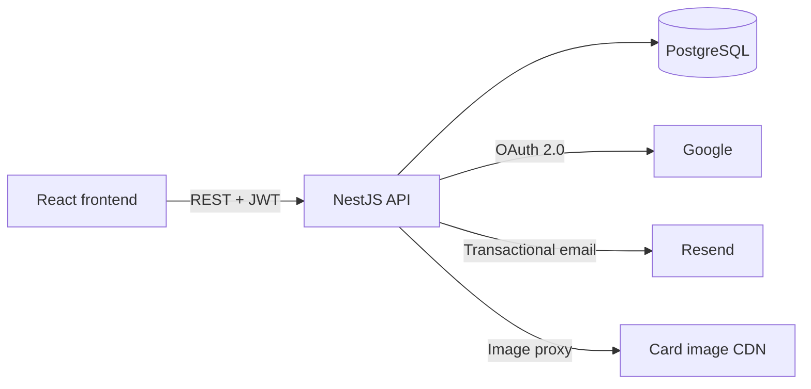
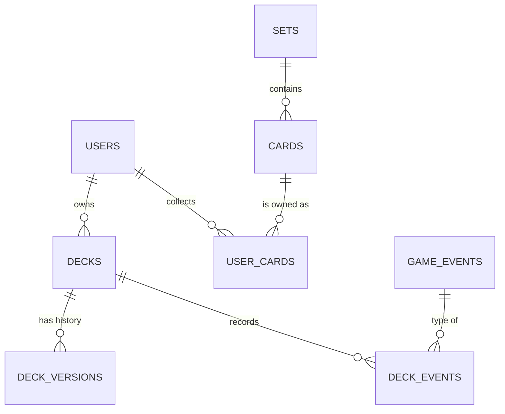

# Ricoll — API

REST API for **Ricoll**, a web app for managing your collection and decks for the
[Riftbound](https://riftbound.leagueoflegends.com/) trading card game. I built it as my final project
(TFG) for the **DAM** degree (Desarrollo de Aplicaciones Multiplataforma).

> Frontend: [terry0w/ricoll-front](https://github.com/terry0w/ricoll-front)

[](https://github.com/terry0w/ricoll-back/actions/workflows/ci.yml)


## Features

- **Card catalog**: every Riftbound card and variant with market prices. You can filter by name, rarity,
  domain, type and set, and results are paginated. Cards are sorted by set and collector number (for
  example `OGN-001`, `OGN-001a`) using SQL `regexp_replace`.
- **Personal collection**: track how many copies of each card and variant (normal, foil…) you own.
  Quantities are updated with a delta (`+1` / `-1`). When a quantity reaches zero, the entry is
  removed.
- **Deck builder with automatic legality checks**: a deck is legal when it has 40 main-deck cards, no
  more than 3 copies of any card, 3 different battlefields and 12 runes. Only legal decks can be made
  public.
- **Deck versioning**: every save stores a JSONB snapshot of the deck with an optional note, so you can
  browse a deck's history.
- **Match tracking and win rate**: log events (casual game, Nexus Night, store tournament, regional
  qualifier…) with matches and per-round results. The deck's win rate is recalculated after each change
  (a draw counts as half a win).
- **Public decks**: explore decks shared by other players. Each one shows the author's nickname and an
  estimated cost based on current card prices.
- **Authentication**
  - Email/password registration with bcrypt-hashed passwords and JWT.
  - **Google OAuth 2.0** login. If a Google account uses the same email as an existing account, the two
    are linked.
  - Email verification and password recovery with a single-use token that expires after 24h. The
    password recovery endpoint always gives the same answer, so nobody can use it to find out which
    emails are registered.
  - The global guard protects every route by default. Public routes opt out with a custom `@IsPublic()`
    decorator.
- **Transactional email** with HTML templates sent through [Resend](https://resend.com). Every send,
  successful or failed, is logged to an `events` table for auditing.
- **Image proxy** endpoint, so the frontend can embed card images in client-generated PDFs without
  hitting CORS errors. Only https URLs from the card CDN are accepted, which prevents SSRF.
- **OpenAPI docs** generated with Swagger at `/api`.

## Architecture

The project follows NestJS's modular structure. Each domain has its own **module → controller →
service → TypeORM entity**. Request bodies are validated with DTOs (`class-validator` and a global
`ValidationPipe`).

```
src/
├── auth/         # register, login, JWT + Google strategies, global guard, email verification, password reset
├── users/        # User entity and data access
├── catalog/      # cards, variants and sets: filtering, pagination, image proxy (raw parameterized SQL)
├── collection/   # cards owned by each user
├── decks/        # decks, versions, events/matches, legality and win rate
├── mail/         # Resend client + HTML templates
├── events/       # audit log (emails sent / failed)
└── common/       # @CurrentUser() and @IsPublic() decorators, shared types
initdb/           # SQL scripts: schema + catalog seed data (run automatically by Docker)
```



### Data model (simplified)



Deck lists (`main_deck`, `runes`, `battlefields`, `sideboard`), version snapshots and match results are
stored as **JSONB** columns. A deck is always read and written as a whole, so this keeps the schema
simple and saves joins.

### Technical decisions

- **Raw SQL for the catalog**: card ordering and dynamic filters were awkward to express with the ORM,
  so they are written as parameterized SQL (`$1, $2…`) and built safely from the active filters. The
  rest of the domain uses TypeORM repositories and the QueryBuilder.
- **Secure by default**: authentication is registered as a global `APP_GUARD`. A new endpoint is
  protected unless you explicitly mark it as public.
- **Email never blocks the user**: welcome and password reset emails are sent fire-and-forget. A Resend
  outage doesn't break registration, and failures still end up in the audit log.
- **Hosted database**: the production database runs on [Neon](https://neon.tech) (serverless
  Postgres) over SSL. It can be configured with a `DATABASE_URL` or with separate variables.

## Main endpoints

Full, interactive reference: **`http://localhost:3000/api`** (Swagger UI).

| Method | Route | Auth | Description |
|---|---|:---:|---|
| `POST` | `/auth/register` · `/auth/login` | — | Register / log in, returns a JWT |
| `GET` | `/auth/google` | — | Start Google OAuth |
| `GET` | `/auth/verify-email?token=` | — | Verify email |
| `POST` | `/auth/forgot-password` · `/auth/reset-password` | — | Password recovery |
| `GET` | `/auth/me` | ✅ | Current user |
| `GET` | `/catalog/cards?name=&rarity=&domain=&cardType=&setName=&limit=&offset=` | — | Filtered cards |
| `GET` | `/catalog/count` · `/catalog/filter-options` | — | Total for pagination / values for the filters |
| `GET` | `/catalog/:id/variants` | — | Variants of a card |
| `GET` · `PATCH` | `/collection` · `/collection/:productId` | ✅ | View / update the collection |
| `POST` · `GET` | `/decks` · `/decks/me` | ✅ | Create a deck / list my decks |
| `GET` · `PUT` · `DELETE` | `/decks/:id` | ✅ | Get / update (new version) / delete |
| `PATCH` | `/decks/:id/public` | ✅ | Publish or unpublish |
| `GET` | `/decks/:id/versions` | ✅ | Version history |
| `POST` · `GET` · `PATCH` | `/decks/:id/events[/:eventId]` | ✅ | Match results |
| `GET` | `/decks/public` · `/decks/public/:id` | — | Explore public decks |

## Running locally

**Requirements:** Node.js 20+, Yarn (or npm) and Docker (for the local database).

```bash
# 1. Install dependencies
yarn install

# 2. Set up environment variables
cp .env.example .env      # and fill in the values

# 3. Start PostgreSQL. On first start it runs initdb/*.sql (schema + card catalog)
docker compose up -d

# 4. Start the API in watch mode
yarn start:dev
```

The API listens on `http://localhost:3000` and the docs are at `http://localhost:3000/api`.

### Environment variables

| Variable | Description |
|---|---|
| `DATABASE_URL` | Full connection string (optional; if set, it overrides the `DB_*` variables) |
| `DB_HOST` · `DB_PORT` · `DB_USERNAME` · `DB_PASSWORD` · `DB_DATABASE` | Database connection |
| `DB_SSL` | `true` to connect over SSL (Neon) |
| `NODE_ENV` | In `production`, TypeORM's `synchronize` is turned off |
| `JWT_SECRET` · `JWT_EXPIRES_IN` | Token signing and lifetime (default `7d`) |
| `RESEND_API_KEY` · `MAIL_FROM` | Email sending |
| `APP_URL` | Frontend URL (used for email links and the OAuth redirect) |
| `GOOGLE_CLIENT_ID` · `GOOGLE_CLIENT_SECRET` · `GOOGLE_CALLBACK_URL` | Google OAuth |

### Scripts

| Command | Description |
|---|---|
| `yarn start:dev` | Development server with hot reload |
| `yarn build` · `yarn start:prod` | Build and run the compiled version |
| `yarn lint` · `yarn format` | ESLint / Prettier |
| `yarn test` · `yarn test:e2e` | Jest tests |

## Roadmap

- [ ] Unit tests for the domain logic (deck legality, win rate, collection) and e2e tests with Supertest
- [x] Restrict the image proxy to an allowlist of domains
- [ ] Replace `synchronize` with versioned TypeORM migrations
- [ ] Rate limiting on the auth endpoints
- [x] CI with GitHub Actions (build + unit tests on every push)
- [ ] Enforce lint in CI and add automated deployment

## Data and disclaimer

The card catalog and prices come from public TCGplayer data (via [tcgcsv.com](https://tcgcsv.com)).
Riftbound and its assets are the property of Riot Games. This is an educational project with no
commercial purpose and no affiliation with Riot Games.

## Author

**Alonso Muñoz** · [GitHub @terry0w](https://github.com/terry0w)
